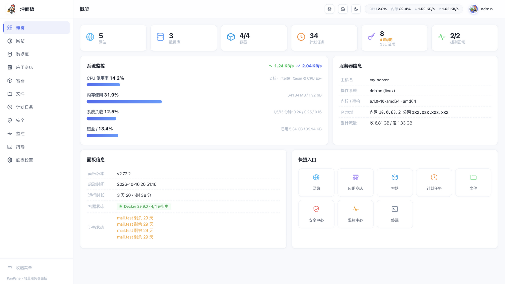
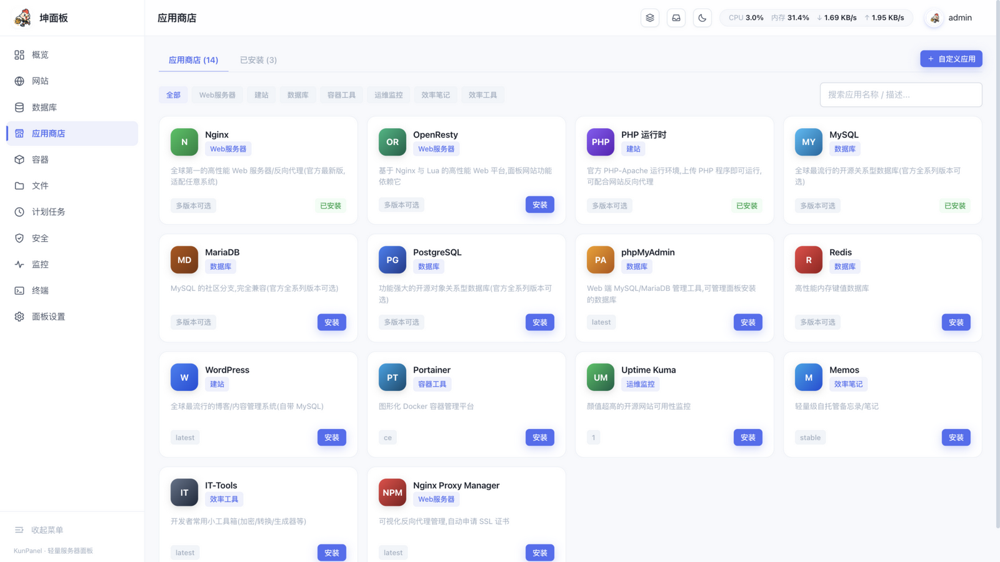
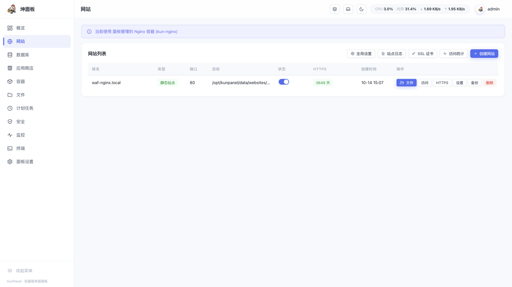
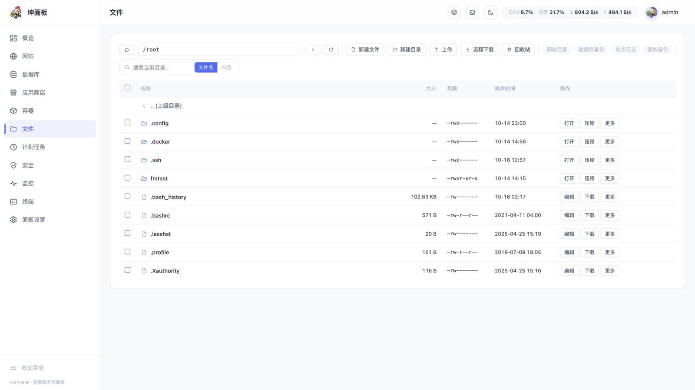
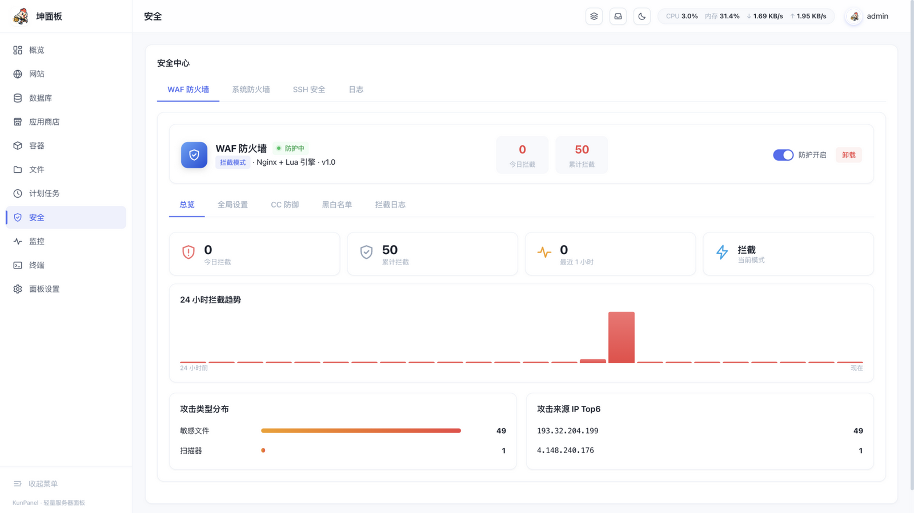
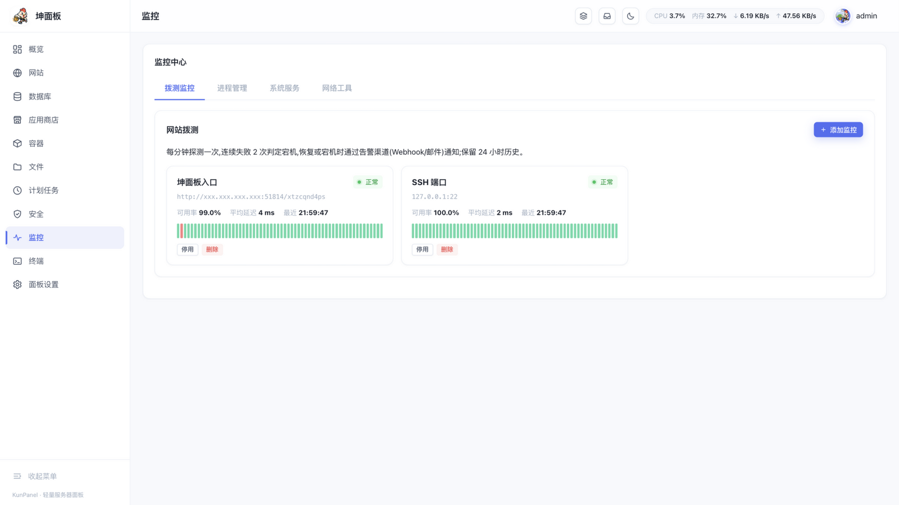

# 坤面板 KunPanel

> 轻量级服务器运维管理面板 —— Go 语言单二进制实现,内嵌全部前端资源,开箱即用。
> A lightweight server management panel in a single Go binary (inspired by 1Panel / 宝塔).

    


<div align="center">

**🎉 特别感谢 [跨境VPS](https://www.kjvps.com) 提供服务器资源赞助**
*专注家宽住宅 IP 云服务器 · 原生 IP / 大带宽 / 高防*

💬 交流 QQ 群:**307386089**(反馈 bug / 功能建议 / 交流运维经验)

</div>

## 一键安装

### Linux

一行命令,自适应发行版(Ubuntu / Debian / CentOS / RHEL / Rocky / Alma / Fedora / openSUSE / Arch / Alpine / Gentoo ...)与架构(x86_64 / aarch64 / armv7),自动识别 systemd / OpenRC / SysV:

```bash
curl -fsSL https://raw.githubusercontent.com/kungec/kunpanel/main/scripts/install.sh | bash
```

安装完成会输出面板地址(随机端口 + 随机安全入口)与随机生成的管理员密码(同时保存在 `/opt/kunpanel/data/initial_password.txt`)。

<details>
<summary>安装参数(点击展开)</summary>

```bash
bash install.sh --port 20000 --username admin --password yourpwd   # 自定义端口与账号
bash install.sh --with-docker            # 同时安装 Docker 引擎
bash install.sh --mirror aliyun          # Docker 使用阿里云镜像源
bash install.sh --proxy https://gh-proxy.com/   # GitHub 下载加速
bash install.sh --version v2.46.4        # 安装指定版本
bash install.sh --offline ./kunpanel_linux_amd64.tar.gz   # 离线安装
bash install.sh --uninstall              # 卸载
```

</details>

### Windows

下载 [release](https://github.com/kungec/kunpanel/releases) 中的 `kunpanel_windows_amd64.zip`,解压后右键**以管理员身份运行** `install.bat` 即可——自动注册 Windows 服务、放行防火墙并输出访问地址。

### Docker

```bash
docker build -t kunpanel:latest .
docker run -d --name kunpanel -p 20000:20000 -v kunpanel-data:/opt/kunpanel/data -v /var/run/docker.sock:/var/run/docker.sock kunpanel:latest
```

## 界面预览

| 概览 | 应用商店 |
|---|---|
|  |  |
| **网站管理** | **文件管理** |
|  |  |
| **安全中心(WAF)** | **监控中心** |
|  |  |

## 功能全景

- **概览**:CPU / 内存 / 负载 / 磁盘 IO / 网络 实时仪表(3s 刷新)+ 24 小时趋势 + 快捷入口
- **网站**:静态站 / PHP 站 / 反向代理;HTTP/2、HSTS、Gzip、浏览器缓存、限速、防盗链、防恶意解析、维护模式、安全响应头、伪静态预设、301 重定向;反向代理**负载均衡**(多上游 + 权重);Let's Encrypt 一键申请与自动续期,证书上传 / 下载 / 自签;站点备份(服务端留存 / 下载 / 上传恢复)
- **数据库**:MySQL / MariaDB / PostgreSQL / Redis 管理,SQL 控制台、表浏览、备份与导入(.sql.gz)、root 改密、phpMyAdmin 快捷入口
- **应用商店**:14+ 应用一键部署(compose 编排),关键应用官方多版本可选;自定义应用(在线编辑 compose 并校验);已安装应用统一管理(启停 / 重启 / 资源限制 docker update / 容器日志清理 / 容器终端 / 检查更新)
- **容器**:Docker 环境、容器 / 镜像 / 网络 / 卷管理、资源监控自动刷新、镜像在线拉取与清理
- **文件管理**:上传(含拖拽)/ 下载 / 远程下载 / 编辑 / 压缩解压 / 权限 / 回收站 / 图片预览 / 常用位置快捷栏
- **计划任务**:7 种类型(Shell / 目录备份 / 数据库备份 / 网站日志切割 / 容器日志清理 / 回收站清理 / 面板备份),宝塔式可视化执行周期(每天 / 每周 / 每月 / 每小时 / N 分钟 / 自定义 cron),失败告警推送
- **安全中心**:WAF 防火墙(OpenResty + Lua:CC 防御与人机验证、IP/UA 黑白名单、敏感文件与危险方法拦截、拦截统计);系统防火墙(UFW / Firewalld);SSH 加固;登录 / 操作日志(导出 CSV);一键安全自检(9 项体检评分)
- **监控**:主机指标 + 磁盘 IO、站点流量统计(PV / UV / Top IP / URI)、拨测监控、告警渠道(邮件 / 钉钉 / 飞书 / Webhook)、消息中心
- **终端**:WebSocket + PTY 在线终端,支持直接进入应用容器
- **后台任务中心**:安装 / 备份等长任务实时日志,顶栏角标,「任务执行中」提示一键直达
- **面板设置**:面板 HTTPS(自签 / 上传)、TOTP 两步验证、安全入口、SFTP 异地备份、自动更新检测提醒

## 安全设计

- **验证码**:PNG 位图(点阵字形 + 描边 + 波浪扭曲 + 噪线);每 IP 限频
- **暴力破解防护**:连续失败 5 次锁定 10 分钟;仅在 `KP_TRUST_PROXY=1` 时信任 `X-Forwarded-For`(反代部署)
- **口令存储**:PBKDF2-HMAC-SHA256(100,000 轮)+ 随机盐,常量时间比较
- **会话令牌**:HMAC-SHA256 签名;修改密码立即轮换签名密钥,旧令牌全部失效
- **注入防护**:域名白名单(阻断 Nginx 配置注入)、应用参数转义 + 端口校验(阻断 compose 注入)、解压防 ZipSlip、路径参数白名单
- **终端 WebSocket**:一次性短时票据(30 秒有效)
- **服务加固**:systemd `NoNewPrivileges` / `ProtectSystem=full` / `PrivateTmp` 等
- **审计**:登录与全部变更操作留痕;安全回归测试 `go test ./internal/security/`
- **端口暴露**:数据库类应用(MySQL/MariaDB/PostgreSQL/Redis)模板默认仅绑定本机回环,公网不可达;注意 Docker 发布的端口不受系统防火墙(ufw/firewalld)约束,如需对外请在面板防火墙页或 compose 中显式放行
- **Docker Socket**:容器部署挂载 `/var/run/docker.sock` 等同于授予宿主 root 级权限(应用商店/容器管理的固有依赖);生产环境建议使用 rootless Docker 或 Socket 代理缩小爆炸半径
- **默认明文 HTTP**:面板默认监听 `0.0.0.0` 的 HTTP,靠随机端口 + 随机安全入口 + 验证码限流防护;公网/不可信网络部署强烈建议在 面板设置→安全 启用 HTTPS,或置于反代之后

## 已验证环境

- ✅ Debian 12 (x86_64, systemd) — 实测:Docker 管理 / WAF / 应用商店 / 终端 / 备份恢复
- ✅ macOS (arm64, 开发环境)
- 理论支持:Ubuntu 20/22/24、Debian 11/12、CentOS 7/8、Rocky/Alma 8/9、Fedora、Alpine 3.x、Arch、openSUSE、Windows Server 2016+ / Windows 10/11

## 从源码构建

```bash
git clone https://github.com/kungec/kunpanel.git
cd kunpanel
bash build.sh v2.46.4        # 产出 release/ 下 linux(amd64/arm64/arm)与 windows 安装包
# 或仅构建本机可执行:
CGO_ENABLED=0 go build -o kunpanel .
```

要求 Go 1.23+。前端为原生 JS(无框架、无 Node 构建步骤),通过 `go:embed` 内嵌进单二进制。

## 目录结构

```
├── main.go                 # 入口(embed 静态资源)
├── internal/
│   ├── server/             # HTTP API(网站/数据库/应用/容器/文件/安全/监控...)
│   ├── websites/           # 站点配置生成(nginx conf 渲染)
│   ├── appstore/           # 应用商店模板与 compose 编排
│   ├── cronx/              # 计划任务引擎
│   ├── plugins/            # WAF(OpenResty+Lua)等插件
│   └── ...
├── web/                    # 前端(原生 JS,无构建步骤)
└── scripts/                # Linux / Windows 安装脚本
```

## 说明

- 数据目录:`/opt/kunpanel/data`(Linux)/ `C:\kunpanel\data`(Windows),网站 / 证书 / 备份都在这里,升级不覆盖
- 卸载:`bash install.sh --uninstall` / `install.ps1 -Uninstall`
- 商店应用以 Docker Compose 编排部署,卸载应用不删除数据卷
- 本项目仅用于合法授权的服务器运维管理,请遵守所在地区法律法规

## License

[MIT](LICENSE)
